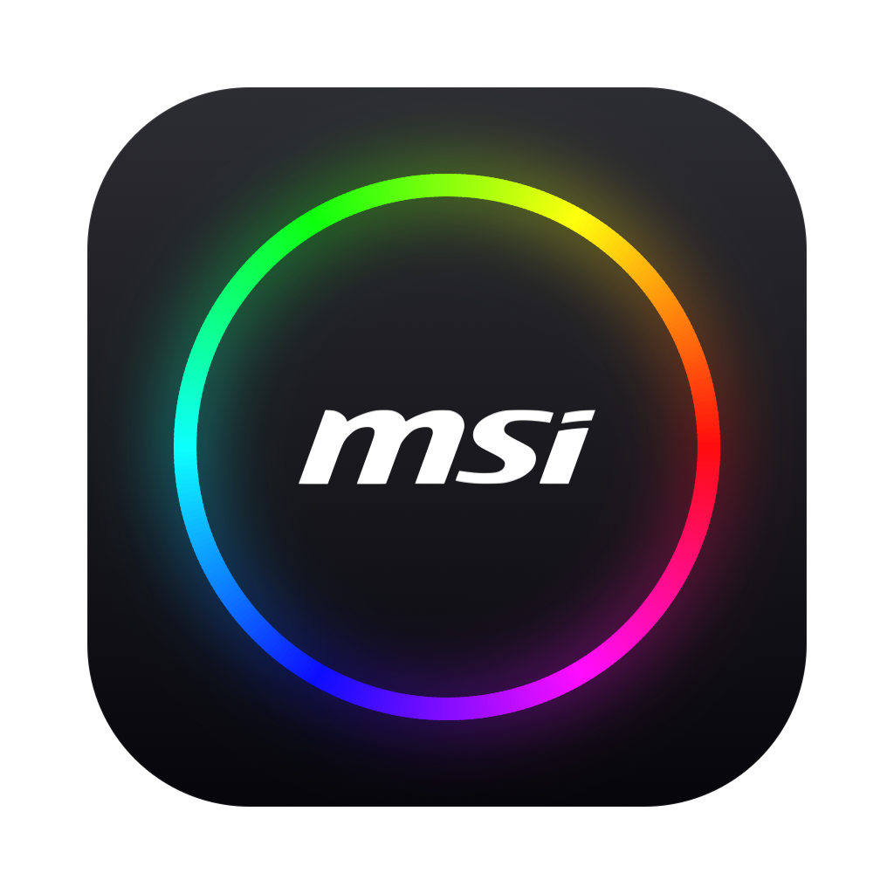
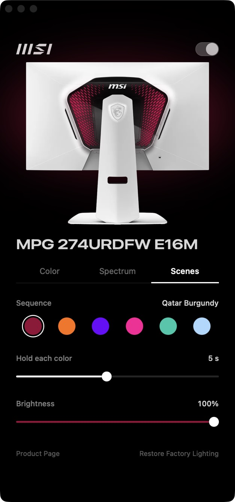
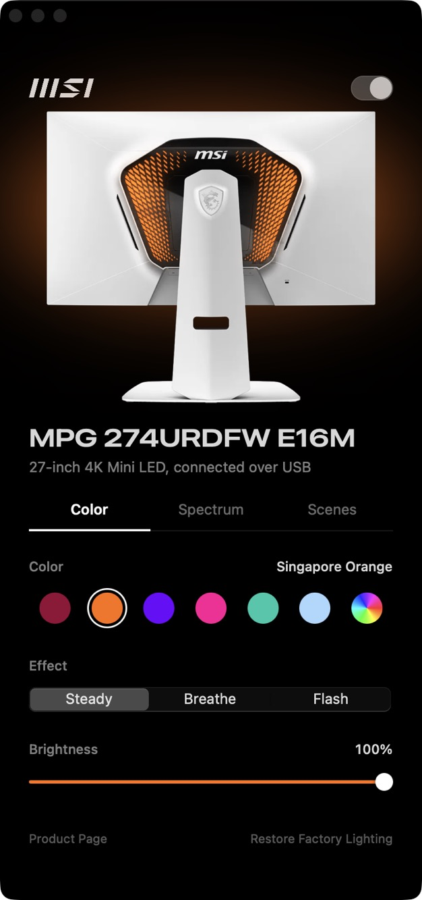

<p align="center"></p>

<h1 align="center">MSI Mystic</h1>

<p align="center">Mystic Light control for MSI monitors on macOS.</p>

<p align="center">
  
  
  
</p>

## Why this exists

I bought a white MSI MPG 274URDFW E16M for my Mac. The back of it has a 44-LED Mystic Light panel, and out of the box it runs MSI's ambient effect, which drifts through every color on its own. MSI's software for changing that, MSI Center and Gaming Intelligence, only runs on Windows. On a Mac the lights just do whatever the monitor decides.

I wanted the lights in my colors: Qatar Airways burgundy, Singapore Airlines orange, a deep purple. So I worked out how the monitor actually takes lighting commands, confirmed it on my own unit one byte at a time, and built the Mac app MSI never shipped.

## Install

Requires macOS 15 or later and Xcode Command Line Tools (`xcode-select --install`).

```bash
git clone https://github.com/shahjacobb/msi-mystic.git
cd msi-mystic
./scripts/build.sh --install
```

That builds a universal app and copies it to `/Applications/MSI Mystic.app`. The monitor's **USB-B upstream cable** has to be plugged into the Mac. HDMI and DisplayPort don't carry the lighting channel.

## What it does

- **Color** sets one color, steady or with the monitor's breathe and flash effects.
- **Spectrum** runs the monitor's own color-cycling effects, Ambient (MSI's factory effect) and Rainbow.
- **Scenes** steps through a sequence of colors on a timer you set.
- **Restore Factory Lighting** writes back the exact packet the monitor shipped with.

Choices are remembered per monitor, so switching tabs or relaunching never loses the color you picked.

## Supported monitors

Every MSI monitor with on-screen settings over USB shows up with the same USB ID, `1462:3FA4`, and reports its model name. MSI Mystic finds it on the upstream cable, reads the name, and asks the monitor which lighting format it speaks.

| Status | Models |
|---|---|
| Verified on hardware | MPG 274URDFW E16M |
| Same lighting format, untested | MPG273CQR, MAG274R, MAG274QRF-QD, MAG274QRX |
| Older 9-LED format, untested | MAG241CR, MAG271CR, MAG271CQR, MAG272CQR, MAG272QP, MAG321CQR, MAG321CURV, MAG251RX |

The untested lists come from [msigd](https://github.com/couriersud/msigd), which documents these models. Before the first change on an untested model, the app saves that monitor's current lighting and asks for permission, so **Restore Original Lighting** can always put it back.

## How it works

The monitor's USB controller exposes a HID feature report for lighting. MSI uses two layouts:

| Report | Size | LEDs per group | Used by |
|---|---|---|---|
| `0x72` | 168 bytes | 24 | MPG273CQR, MAG274 series, MPG 274URDFW |
| `0x71` | 78 bytes | 9 | Older MAG models |

Both share the same structure:

| Bytes | Contents |
|---|---|
| 0 | Report ID |
| 1–11 | Group 0 header: mode, red, green, blue, speed, brightness, five fixed bytes |
| 12–22 | Group 1 header, same layout |
| 23 onward | One red, green, blue triplet per LED, group 0 then group 1 |

Mode bytes: `0x00` off, `0x01` steady, `0x02` breathe, `0x05` flash, `0x1A` rainbow, `0x21` MSI's ambient effect.

On the MPG 274URDFW, group 0 holds one LED and group 1 holds 22 color slots, which drive the 44 physical LEDs in pairs. Rather than hardcoding that, the app reads the monitor's own packet and writes only the slots that are populated, so the same code adapts to other layouts.

**Safety.** The app only ever writes the lighting report, always built on top of a packet the monitor itself returned. It never touches picture or OSD settings, which msigd warns can damage a monitor. Writes are limited to about 8 per second, and color-cycling effects run on the monitor's own controller rather than being streamed from the Mac.

## Adding a monitor

Everything model-specific is optional and lives in `MonitorModel.lookup` in `Sources/LightController.swift`:

- **Product page link.**
- **Factory packet**, read from a new unit, so Restore Factory Lighting works out of the box.
- **Rear product photo.** Take MSI's gallery image of the back (it already has a transparent background) and split out the LED mask:

  ```bash
  python3 scripts/extract-leds.py rear.png Resources/<model>-rear.png Resources/<model>-rear-leds.png preview.png
  ```

  The preview then lights the monitor's real LED pattern. Models without a photo get a generic monitor drawing.
- **`verified: true`** once lighting is confirmed on real hardware.

## How common is this?

**Within MSI:** common. The monitors share one USB ID and two lighting layouts, so one app covers the line.

**Across the industry:** there's no shared standard in practice. Each brand uses its own USB protocol, and open-source tools like OpenRGB add support one vendor at a time. OpenRGB only gained an Acer monitor controller in version 0.9. Microsoft's HID LampArray, the standard behind Windows Dynamic Lighting, is meant to fix that, but this monitor's USB descriptor exposes no LampArray interface, only MSI's vendor report. On Windows, any Dynamic Lighting support has to go through MSI's software.

## Development

```bash
./scripts/test.sh     # packet regression tests, no monitor needed
./scripts/build.sh    # build/MSI Mystic.app
swift scripts/make-icon.swift
```

`Tests/fixtures/mpg274urdfw-factory.bin` is the lighting packet read from a new MPG 274URDFW E16M. The tests check that the built-in factory data matches it, and that packets stay byte-identical when the code changes.

| File | Role |
|---|---|
| `Sources/MSIDevice.swift` | USB HID transport, layout detection, packet building |
| `Sources/LightController.swift` | Modes, colors, per-monitor memory, model catalog |
| `Sources/ContentView.swift` | Interface |

## History

<p>
  
  
  
  
</p>

1. **MSI Light.** A glowing orb, icon tiles, and a color wheel. It worked, but looked generated.
2. **Lume.** A drawn monitor with light on the wall behind it, text tabs, and hairline dividers.
3. **MSI Monitor Lighting.** MSI's own rear product photo with the LED dots lit live, and modes grouped into Color, Spectrum, and Scenes.
4. **MSI Mystic.** Works with any MSI monitor, remembers choices, and has tests.

## Credits

The packet layout was learned from [msigd](https://github.com/couriersud/msigd) by couriersud (GPL-2.0). This is an independent Swift implementation. The MSI logos are Wikimedia Commons renders of MSI's marks, and the product photo is from msi.com. MSI, Mystic Light, and the MSI logos are trademarks of Micro-Star International. This is a personal project, not affiliated with MSI.
