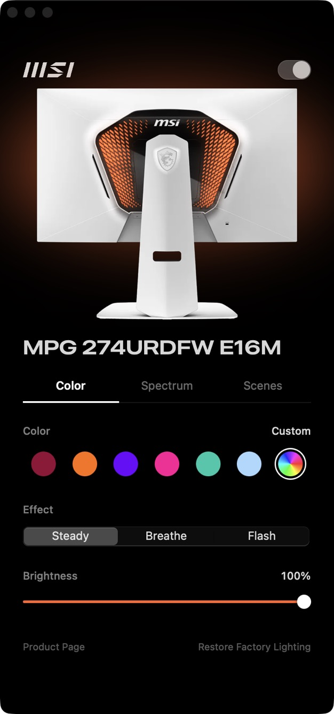
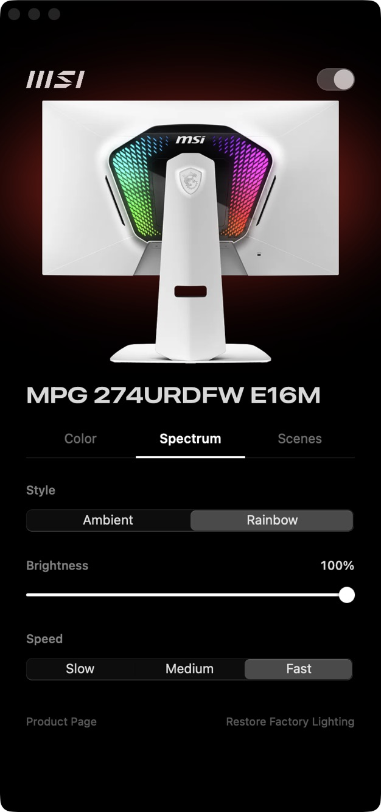

<p align="center"></p>

<h1 align="center">MSI Mystic</h1>

<p align="center">Control the lighting on MSI monitors from a Mac.</p>

<p align="center">
  
  
  
</p>

MSI's Mystic Light software only runs on Windows, so on a Mac the LEDs on the back of an MSI monitor stay on whatever effect the monitor defaults to. MSI Mystic is a native macOS app that changes them over the monitor's USB cable.

## Features

- Any color, steady or with breathe and flash effects
- The monitor's built-in Rainbow and Ambient effects
- Scenes: cycle through a set of colors on a timer
- Brightness and speed control
- One-click restore to the factory lighting
- Settings are remembered for each monitor

## Requirements

- macOS 15 or later, on Apple silicon or Intel
- An MSI monitor with Mystic Light
- The monitor's **USB-B upstream cable** connected to the Mac. HDMI and DisplayPort don't carry the lighting controls.

## Install

Install Apple's command line tools if you don't have them:

```bash
xcode-select --install
```

Then build and install:

```bash
git clone https://github.com/shahjacobb/msi-mystic.git
cd msi-mystic
./scripts/build.sh --install
```

MSI Mystic is now in your Applications folder.

## Compatibility

| Monitor | Status |
|---|---|
| MPG 274URDFW E16M | Tested |
| MPG273CQR, MAG274R, MAG274QRF-QD, MAG274QRX | Same lighting format, not yet tested |
| MAG241CR, MAG271CR, MAG271CQR, MAG272CQR, MAG272QP, MAG321CQR, MAG321CURV, MAG251RX | Older lighting format, not yet tested |

Other MSI monitors may work too. The first time you change the lighting on an untested model, MSI Mystic saves the current lighting and asks before writing anything, so **Restore Original Lighting** can always put it back.

If you try it on a monitor that isn't marked tested, please [open an issue](../../issues) with the model name and whether it worked.

## FAQ

**My monitor says "No Monitor."**
Check that the USB-B cable runs from the monitor to the Mac. If it goes through a hub or dock, try plugging it into the Mac directly.

**Is it safe?**
The app only changes lighting. It never sends picture, input, or other menu settings, and on untested models it saves the existing lighting before its first change. [docs/PROTOCOL.md](docs/PROTOCOL.md) explains exactly what it sends.

**Does the app need to stay open?**
No, except for Scenes. The monitor keeps the lighting you set after you quit. Scenes changes colors on a timer, so the app has to be running for that.

**Does it work with other brands?**
No. Every brand uses its own lighting protocol, and this app only speaks MSI's.

## Contributing

Bug reports and tested-model reports are welcome. To add support for a new model, including a product photo for the preview, see [docs/PROTOCOL.md](docs/PROTOCOL.md#adding-a-monitor). Run `./scripts/test.sh` before sending changes.

## Credits

The lighting packet format was first documented by [msigd](https://github.com/couriersud/msigd). MSI Mystic is a separate implementation written in Swift.

MSI Mystic is not affiliated with or endorsed by MSI. MSI, Mystic Light, and the MSI logos are trademarks of Micro-Star International. The product photo is from msi.com.

## License

[MIT](LICENSE)
