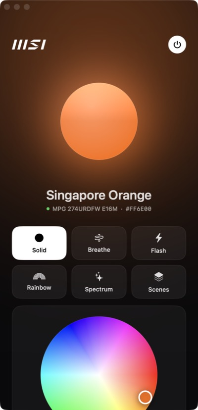
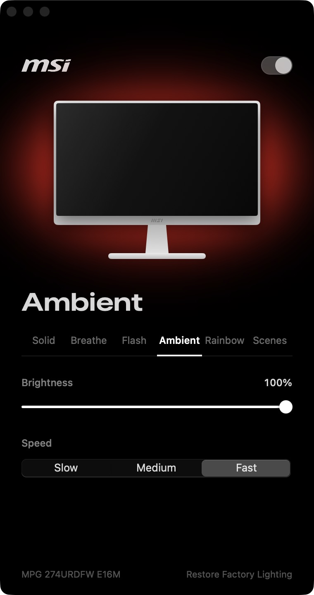
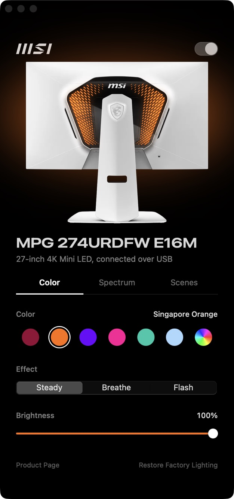
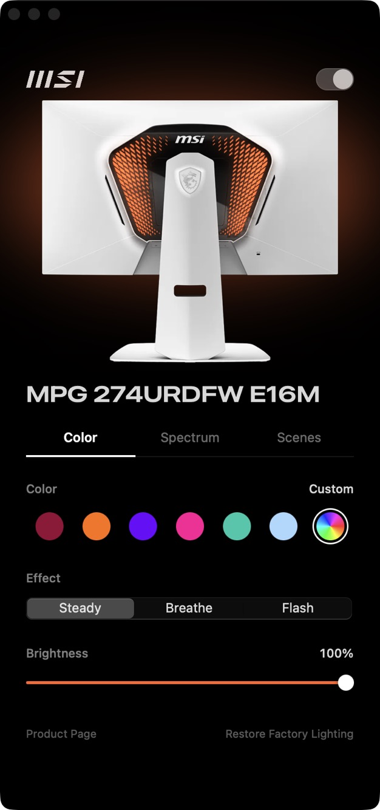

# Design history

  
  
  
  

1. **First version.** A glowing orb, icon tiles, and a color wheel. It worked, but it looked generic.
2. **Monitor preview.** A drawn monitor lighting the wall behind it, text tabs, and hairline dividers in place of cards.
3. **Product photo.** MSI's rear product photo with the LED dots lit live, and modes grouped into Color, Spectrum, and Scenes.
4. **MSI Mystic.** Works with any MSI monitor, remembers settings per monitor, and has packet regression tests.
